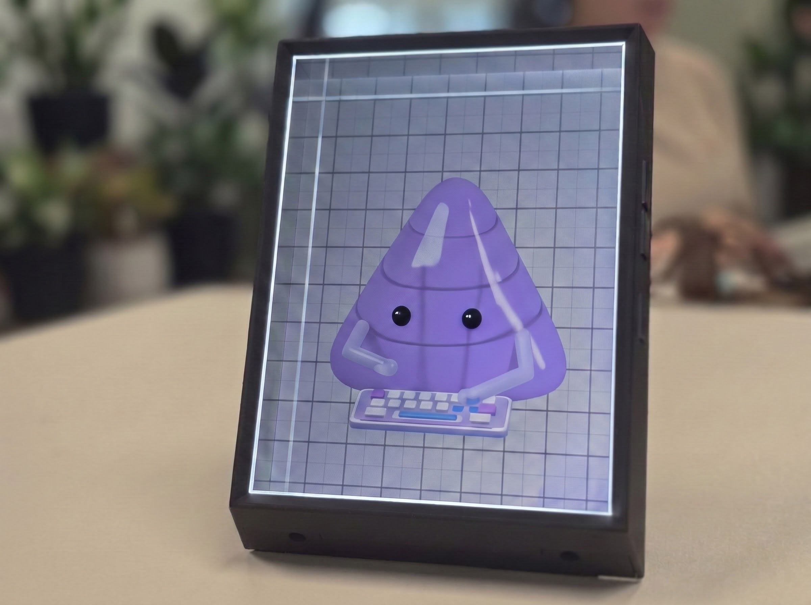

# Portrait Direct



A small native macOS app and Three.js light-field renderer for the **original Looking Glass Portrait (1536 × 2048)**. Uses Cocoa + the system WebKit GPU process; no Electron, Bridge service, Studio, cloud, video encoding, or framebuffer readbacks in the rendering path.

**Tested on a connected Looking Glass Portrait and confirmed working well.** Calibrated hologram output has been exercised at unmirrored 1536 × 2048 / 60 Hz, including the smooth and furry animated characters. This remains an experimental user-space renderer; macOS handles HDMI. Comparative speed and battery savings have not been benchmarked.

## Run

Open [`build/Portrait Direct.app`](build/Portrait%20Direct.app) in Finder. The app is built for this Apple Silicon Mac, ad-hoc signed, and uses macOS 14+. It runs offline without Node installed.

To rebuild (Node 22.12+ and Xcode command line tools):

```sh
npm ci --include=dev
npm test
npm run build:app
open "build/Portrait Direct.app"
```

For browser preview, use `npm run dev`, then open the printed localhost URL. Browsers preview scenes and import models/calibration; exact display selection is provided by the native app.

## Connect the device

1. Connect HDMI and USB power. Start with the Mac's built-in HDMI port to remove a hub/adapter as a variable. The vendor requires adapters capable of at least 4K at 30 Hz for Portrait.
2. In macOS Displays, set the Portrait to **extended, unmirrored 1536 × 2048** with native pixel mapping. The app checks backing dimensions and active display-mode pixel dimensions. It never changes resolution or refresh rate automatically.
3. Choose **Import calibration**. Select `Visual.json` (sometimes `visual.json`) from `LKG_Calibration` on the Portrait's mounted drive, or your saved copy. If the drive/file is unavailable, the vendor documents exporting it using Bridge once. This app does not implement a USB calibration protocol or use invented default calibration. Check that the serial shown matches your device; matching the calibration to an HDMI display is manual.
4. Select the display. Try **Static connection test** first; it needs no calibration. If stable, choose **Calibrated hologram**, then **Start output**. Press Escape or Stop output to close it.

The app deliberately does not start output automatically after a disconnect. A change to display geometry or mirroring stops output. The native output window covers the panel without borders. Use the static test pattern to check native-pixel mapping when setting up a different display or adapter. macOS colour transforms, Night Shift or third-party display tools can affect optical output; disable those on the Portrait during alignment checks.

## Web 3D content

The default scene is **Purple triangle · Working**, based on `~/Downloads/projects/alpha-bro-pets`: its rounded triangle outline and smooth 820 ms typing cycle. The character has an inflated lavender body, small glossy eyes and rounded hands and keyboard, lit against a white studio background with a soft floor shadow. Choose **Play working** to animate the hands, body, eyes and keyboard. Motion stays facing you; drag to turn it. Pause freezes the pose and lets the renderer sleep. The character is bundled offline and appears in both preview and calibrated Portrait output without importing a model.

The body is a closed curved mesh, and the eyes follow its surface as it moves. The floor shadow uses one analytical transparent mesh, keeping the softness in every light-field view without shadow maps or per-frame blur work.

Choose **Furry triangle · Working** in the Scene menu for a fluffy lavender version. It adapts Alpha Bro Pets' groomed, tapered strand ribbons, clumping, curl and hair lighting to the Portrait. Fur stays short around the eyes, sways in analytical wind and trails body rotation and squash with a damped spring updated once per scene frame. Pause freezes the coat as well as typing. Eco, Balanced and Detail use 8,000, 16,000 and 24,000 strands respectively, switching density without reallocating geometry. This strand-only adaptation omits the reference app's shell stack and GPU physics passes to limit the cost of rendering every holographic view. The smooth triangle remains available, and either version projects through the same calibrated output path.

The furry version uses a longer, draping coat with finer eight-segment fibers and softer root-to-tip shading. A damped spring responds to body acceleration, rotation and squash, with follow-through at the hair tips. Fur stays trimmed around the eyes and keyboard. Its state is updated once before all holographic views, and Pause freezes the body and coat together.

Choose **Liquid glass triangle · Working** for Alpha Bro Pets' physical glass styling: lavender absorption, curved refraction, subtle color dispersion and soft studio reflections. A stationary gray line grid sits behind the character as real scene geometry, visibly bending through the body. The face stays out of the refraction capture to avoid duplicate eyes. The same typing animation, drag rotation and pause controls apply.

To project a character, select its style in **Scene**, choose **Calibrated hologram**, then **Start output** after connecting the display and importing its calibration. Use **Play working** to enable animation. The same live Three.js character is rendered from every light-field camera; this is not a flat sprite or a video. The scene selection and motion preference are saved by the native app.

The **Scene** menu also offers the original Orbital study. You can load a **self-contained `.glb`, `.stl` or `.3mf` under 64 MB** in the browser preview or native app. GLB must be uncompressed. Both ASCII and binary STL are supported, with a default material for files without colors. STL and 3MF use the conventional Z-up printing orientation and are fitted to the preview. Framing ranges from **50–300%**. Draco, KTX2 and Meshopt decoders are not bundled; external model resources are not supported. 3MF support follows the bundled Three.js loader; vendor-specific slicer extensions may not render fully. Imported model animation clips are not played; Play motion turns the model. Selecting a built-in scene leaves the imported model; Reset scene restores the paused purple triangle.

For a custom web scene, replace `createScene()` in `src/scene.ts`, keeping its `{ scene, content, update(seconds), setProfile(profile) }` return contract, and rebuild. `setProfile` can be a no-op if the scene does not vary with quality. Put dynamic updates in `update`; the scheduler calls it once before all views, using a clock that stops when paused, hidden or suspended. Set animation only when needed, or call `scheduler.invalidate()` after a scene change. Your Three.js geometry, materials and shaders run directly in WebKit. DOM/CSS overlays do not become holograms.

For integration into another Three.js application, `src/renderer.ts` exposes the renderer independently:

```ts
import { PortraitRenderer } from './src/renderer';
import { parseCalibration } from './src/calibration';
const display = new PortraitRenderer(canvas);
display.configure('balanced', parseCalibration(myVisualJson));
display.render(myThreeScene, 'hologram', 1536, 2048);
// Re-render when the scene changes; dispose() when closing.
```

The scene's screen/convergence plane is z=0, camera axis is +z looking toward -z. The vertical field at default framing is about 3.17 scene units, with 0.75 aspect on the Portrait. Cameras use parallel, off-axis frusta. Existing arbitrary websites/iframes cannot be converted to light fields from their 2D pixels: their scene/render loop needs integration. This is not a WebXR drop-in polyfill.

## Energy and performance design

| Mode | Views | Quilt | Motion cap |
|---|---:|---:|---:|
| Eco | 24 | 1440 × 1280 | 24 fps |
| Balanced | 48 | 2520 × 2520 | 30 fps |
| Detail | 48 | 3360 × 3360 | 30 fps |

Motion is off by default. Static content sleeps after its dirty frame. A timer plus vsync caps animation without a continuously polling 60/120 Hz loop. Low Power Mode selects Eco. The laptop's preview pauses during output; sleep pauses rendering. The app does not keep the display/system awake. The smooth and furry scenes use one quilt target and one direct GPU interlacing pass without MSAA. Liquid glass adds Three.js's reusable, tile-sized multisampled transmission target, rendered for each view, and a small studio reflection map generated once per renderer. There are no per-frame texture readbacks, canvas-to-canvas copies or video transport. Eco trades angular resolution for lower cost; test its quality on the device.

The shown timing is **CPU submission**, not GPU execution or end-to-end latency. Initial shader compilation can produce a slow first frame. No claim of outperforming Bridge/Studio or measured battery savings is made. The panel continues consuming power and receiving HDMI scanout even when scene rendering sleeps. For comparisons, use the same scene and panel mode, then measure sustained GPU time, frame cadence, total process memory and battery/energy use after warm-up.

## Validation

All **14 automated tests** pass. `npm test` checks calibration parsing/rejection, the optical parameter conversion, every off-axis camera's convergence, frame coalescing, idle/suspend/dispose and animation caps. Character tests check the original typing poses, continuous looping, key and paw motion, fixed geometry allocations, framing bounds and disposal of shared resources. Fur tests cover deterministic coverage, normals and eye tapering, density changes, spring lag and settling, pause behavior and reuse of geometry attributes.

`tests/browser-check.ts` renders synthetic view-coded quilts and compares real GPU output pixels with an independent CPU optical calculation for every quality profile. Glass checks verify visible grid refraction and compare the first, middle and last quilt views against independently rendered cameras in each profile, allowing small rasterization differences at high-contrast edges. Readbacks exist only in this test. Run with browser-harness while the dev server is open:

```python
print(js('(async()=>JSON.stringify((await import("/tests/browser-check.ts")).checkGPU()))()'))
```

Native WebKit preview, idle and GPU checks (no device needed):

```sh
node scripts/build-gpu-check.mjs
"build/Portrait Direct.app/Contents/MacOS/PortraitDirect" \
  --smoke-test "$PWD/artifacts/native-preview" \
  --gpu-check "$PWD/artifacts/gpu-test/gpu-check.js"
```

Reports and a native WebKit snapshot are saved beside the chosen prefix. These automated checks verify software rendering; connected-device testing has also exercised calibrated output with both characters, and the Portrait is confirmed working well. Recorded Chrome and native WebKit GPU checks pass for all quality profiles, including the fur shader, with zero sampled 8-bit error in the synthetic interlacing fixture.

Extended unplug/replug and sleep/wake testing, long-duration stability measurements and controlled energy/performance comparisons remain separate follow-up work. See [`VALIDATION.md`](VALIDATION.md) for the dated implementation and test history; its earlier hardware-pending notes describe the observations available at those stages.

Local settings and the imported model are stored in `~/Library/Application Support/Portrait Direct/`. Nothing is sent over the network by the bundled app. See `THIRD_PARTY_NOTICES.md` for licenses.

## Primary references

- [Portrait setup](https://lfdocs.lookingglassfactory.com/getting-started/portrait/get-started-with-looking-glass-portrait)
- [macOS display settings and pixel resolution](https://lfdocs.lookingglassfactory.com/software/looking-glass-bridge/display-settings-on-macos)
- [Looking Glass WebXR source](https://github.com/Looking-Glass/looking-glass-webxr)
